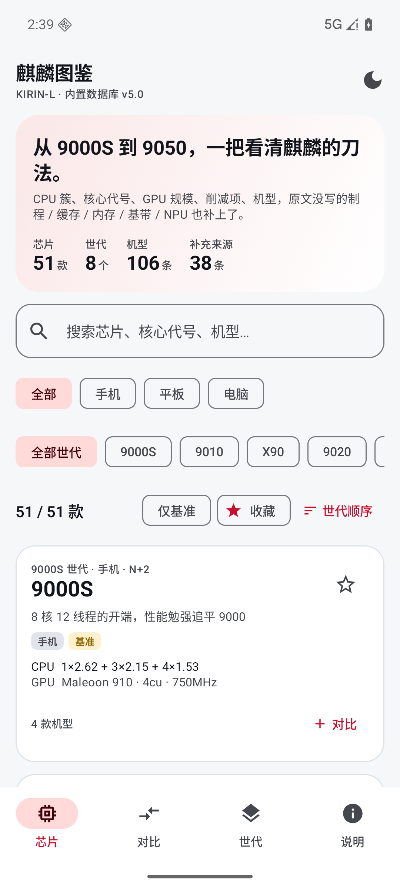
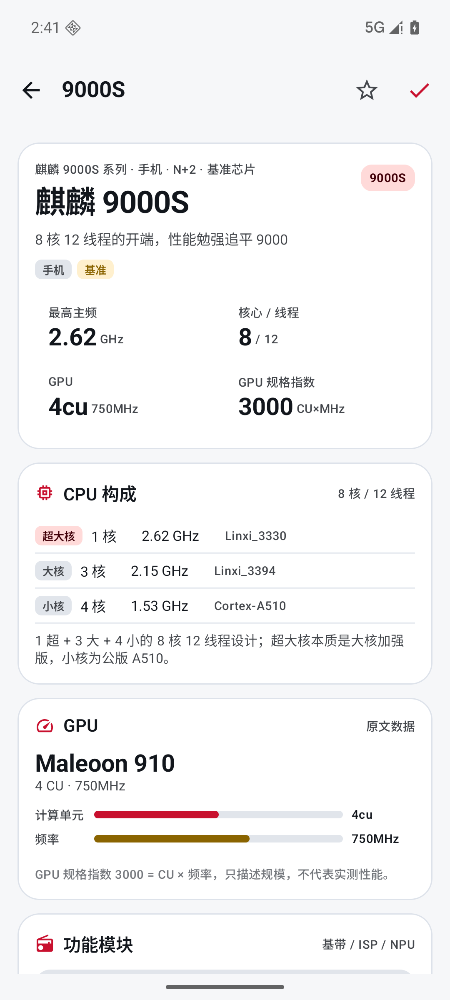
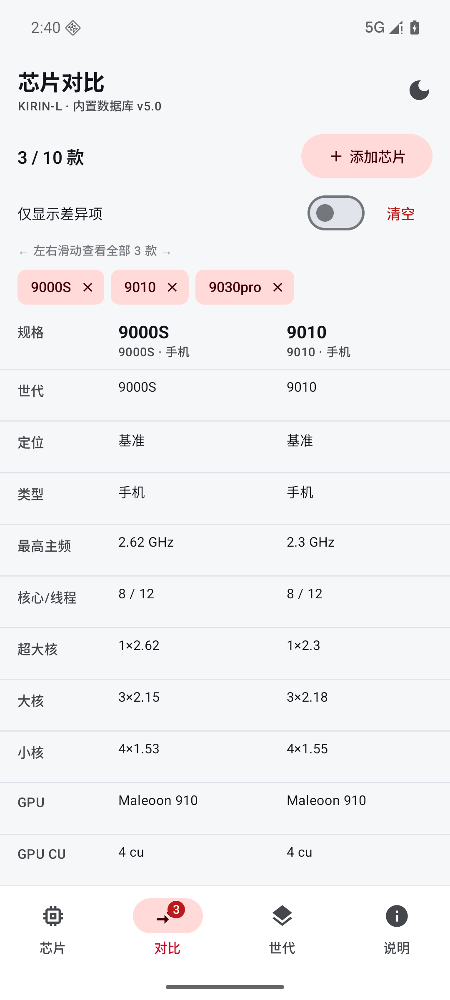
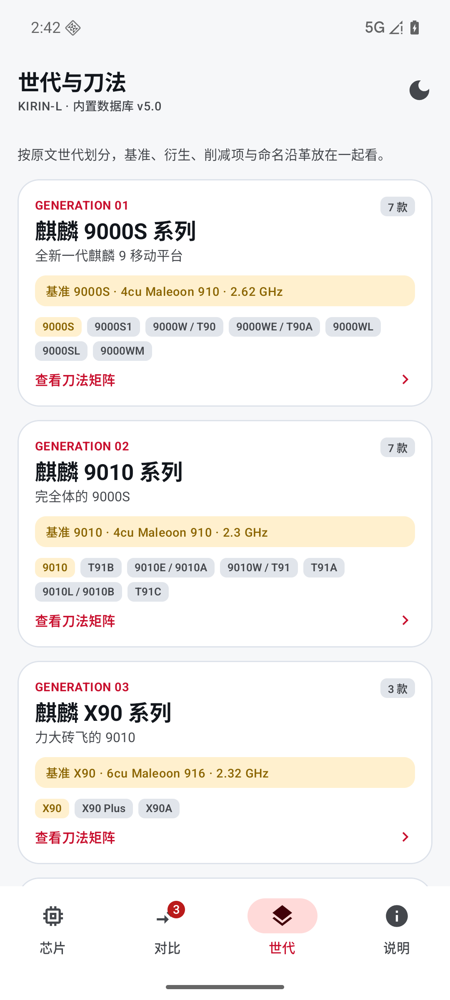
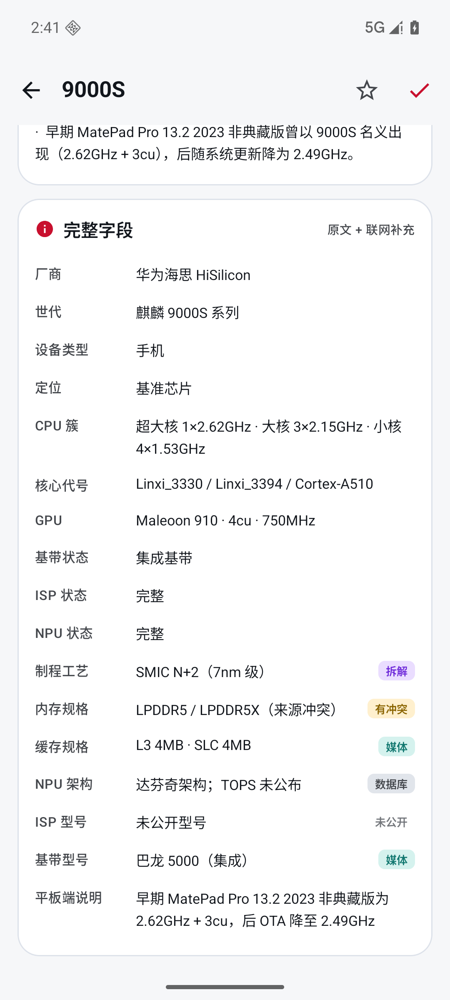
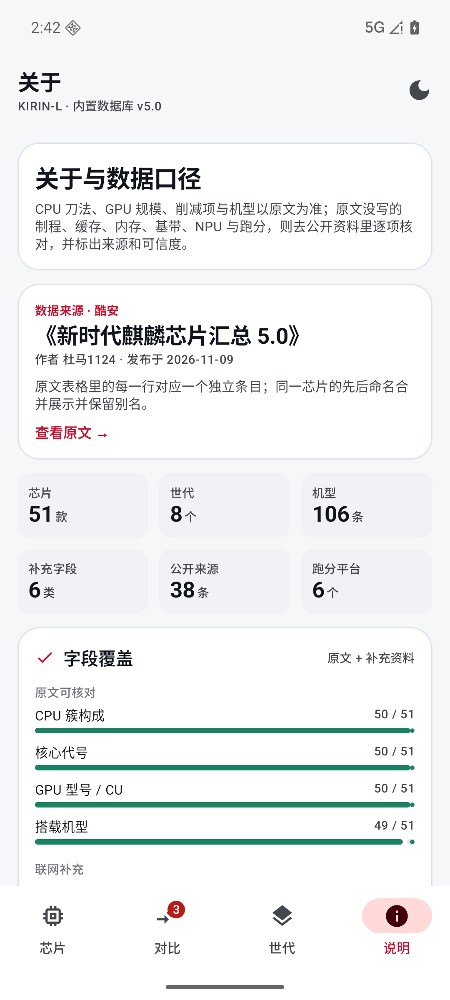

# 麒麟芯片图鉴 · Kirin-L

原生 Android App（Kotlin + Jetpack Compose + Material 3），参考 SoC-L 的芯片库 / 收藏 / 多芯片对比结构，针对麒麟补齐了 SoC-L 容易缺失的字段。

<p>
  
  
  
</p>

## 下载与安装

本仓库**不发布 APK 产物**（二进制不入库），请从源码构建：

```bash
cd native
export JAVA_HOME=/path/to/jdk17
./gradlew assembleRelease
adb install --no-incremental app/build/outputs/apk/release/app-release.apk
# 模拟器上增量安装偶发空白，统一用 --no-incremental
```

- 版本 2.0.0 / versionCode 3，minSdk 26（Android 8.0），约 11MB。
- **当前版本完全离线**：数据编译进 APK，Manifest 未申请网络权限。
  （从 GitHub 拉 JSON 做动态更新是后续可选项，见「数据动态更新」。）
- release 使用 `android/debug.keystore` 签名；该文件不入库，克隆后需自行生成或改用
  自己的签名配置。签名不同则无法覆盖安装旧版，需先卸载。

## 功能

- **芯片库**：51 款芯片 / 8 个世代，搜索芯片、核心代号、机型；按手机 / 平板 / 电脑、世代筛选；主频 / GPU / 名称排序；收藏。
- **详情**：CPU 三簇（核数 / 频率 / 核心代号）、GPU 规模与频率、基带 / ISP / NPU 状态、相对基准的降频 / 砍核 / 砍 GPU / 砍 ISP / 砍 NPU / 无基带、机型、相关芯片、原文要点、完整字段。
- **补充资料**：制程、内存、缓存、NPU、ISP、基带六类，逐项标「官方 / 拆解 / 媒体 / 数据库 / 推断 / 有冲突 / 未公开」与来源链接；跑分单列，标机型。衍生型号自动沿用同系列基准并标「同系列基准」。
- **对比**：最多 10 款并排，横向滑动表格；上滑时「规格」表头冻结在顶部，列名始终可见；已选芯片可一键移出；仅显示差异项；最高值标红；规格条形图。
- **世代与刀法**：世代卡片、刀法矩阵、衍生树、命名沿革、原文衍生规则。
- **说明**：38 条公开来源、字段覆盖、6 条主要发现、9 条冲突/缺口、可信度图例。
- **动效**：Tab 滑动淡入、详情页侧滑进入、卡片筛选重排、结果数与条形图增长、主题图标切换、徽章数字变化。
- 深 / 浅色主题；收藏与对比列表保存在本机。

<table>
  <tr>
    <td></td>
    <td></td>
    <td></td>
  </tr>
</table>

## 构建

环境：JDK 17、Android SDK 36（build-tools + platform）、Gradle wrapper（工程自带）。

```bash
cd native
export JAVA_HOME=/path/to/jdk17
./gradlew assembleRelease
# 产物：native/app/build/outputs/apk/release/app-release.apk
# 已复制：native/out/kirin-l.apk
```

调试：

```bash
./gradlew assembleDebug
adb install -r app/build/outputs/apk/debug/app-debug.apk
```

工程使用 Kotlin 2.1.20、AGP 8.9.1、Compose BOM 2025.04.01、Material 3，compileSdk 36 / targetSdk 35。

## 数据来源

### 主数据源

- 酷安《新时代麒麟芯片汇总 5.0》，作者 **杜马1124**，发布 2026-11-09：
  <https://www.coolapk.com/feed/74959496>
- 原文层（以此为准）：CPU 簇、核心代号、GPU、机型、削减项、命名沿革。
- 原文致谢：@CyanDawn、@伤心萨摩耶（机型清单等补充）。

### 联网补充层

- 制程、缓存、内存、基带、NPU、跑分等原文未给出的字段，于 2026-11-17 逐项核对。
- 共 **38 条公开来源**，全部写在数据文件的 `sources` 字段里，App「说明」页可逐条点开，
  包括华为官网/支持页、百度百科、IT之家、快科技、EET-China、Notebookcheck、
  NanoReview、DeviceInfo、PhoneDB 等。
- 每条补充字段标注「官方 / 拆解 / 媒体 / 数据库 / 推断 / 有冲突 / 未公开」与来源链接；
  查不到的字段标「未查到 / 未公开」，不做猜测。

### 已知冲突

- 9000S 内存（LPDDR5 vs LPDDR5X）、9050 Pro 内存（LPDDR5X vs LPDDR6）、
  9020 小核 L2（1MB vs 2MB）、9050 Pro 线程（原文 14 vs 官方 16，采用官方）、
  X90 频率（原文 2.32GHz vs 部分报道 4.2GHz，保留原文）。

### 数据文件

- `js/data.js`：唯一数据源（Web 原型与原生共用）。
- `data/kirin.json`：同一份数据的机器可读导出（51 芯片 / 8 世代 / 38 来源），
  供动态更新或第三方复用。
- 修改数据后重新生成 Kotlin：`cd native && node tools/gen_data.js`。

> `data/_source/` 是原文截图，仅用于本地校对，**不入库**（第三方内容，不二次分发）。
> 本项目只整理事实性参数并注明出处，原文版权归原作者所有。

## 数据动态更新（可选，尚未接入）

可以。`data/kirin.json` 就是为 App 拉取准备的稳定 JSON：

- 固定地址（`main` 分支）：
  `https://raw.githubusercontent.com/yhx5768/kirin-l/main/data/kirin.json`
- 国内网络建议配镜像（`raw.githubusercontent.com` 经常不可达）：
  `https://cdn.jsdelivr.net/gh/yhx5768/kirin-l@main/data/kirin.json`，或自建反代。
- 建议流程：
  1. App 增加 `INTERNET` 权限与后台更新器；启动先加载内置数据，保证离线可用。
  2. 请求 JSON 时带 `If-None-Match` / `If-Modified-Since`，超时 5s，比较
     `meta.dataVersion` / `meta.updated`。
  3. 校验 `schema`、大小上限与字段完整性，写入 `filesDir` 缓存；
     解析失败或网络失败一律回退内置数据。
  4. 缓存数据在下次启动或手动「检查数据更新」时生效。
  5. `raw` JSON 没有签名，只能防传输损坏、不能防仓库被改；要求高可另加
     minisign 签名文件或从 Releases 拉带校验和的包。

当前 App 仍把数据编译进 `KirinData.kt`，UI 直接引用顶层 `chips`；要接入动态更新需要加一层
`DataRepository`（内置数据 → 缓存 JSON 覆盖）并补 JSON 解析，这是下一步工作。

## 目录

```
kirin-soc/
├── native/                    # 主交付：原生 Android
│   ├── app/src/main/java/com/kirinl/app/
│   │   ├── MainActivity.kt
│   │   ├── data/KirinData.kt  # 自动生成
│   │   ├── data/DataExt.kt
│   │   └── ui/                # Compose 屏幕与组件
│   ├── tools/gen_data.js      # js/data.js → Kotlin
│   └── build.gradle.kts
├── js/data.js                 # 数据源（Web + 原生共用）
├── data/kirin.json            # 机器可读数据导出（动态更新用）
├── web 原型：index.html / css / js / sw.js
├── android/                   # 旧 WebView 壳（legacy）
└── docs/                      # 截图
```

## Web 原型（legacy）

根目录的 `index.html` / `css` / `js` 是最初的 PWA + WebView 版本，保留用于数据校对与对照，**不再是最终 App**。需要时：

```bash
python3 -m http.server 8787
# http://localhost:8787
```

旧 WebView 源码保留在 `android/`，APK 产物不入库。

## 验证

- 原生 App 在 Android 16 模拟器实测：首页、搜索、筛选、详情、补充资料、完整字段、对比（含差异开关 / 横向滑动 / 移出）、世代矩阵、衍生树、说明页、主题切换、系统返回键均正常。
- 51 张芯片卡、38 条来源、6 类补充字段加载正常；release APK 冷启动与滚动流畅。
- 与旧 WebView 版同签名；`versionCode 3` 可覆盖旧版升级。
